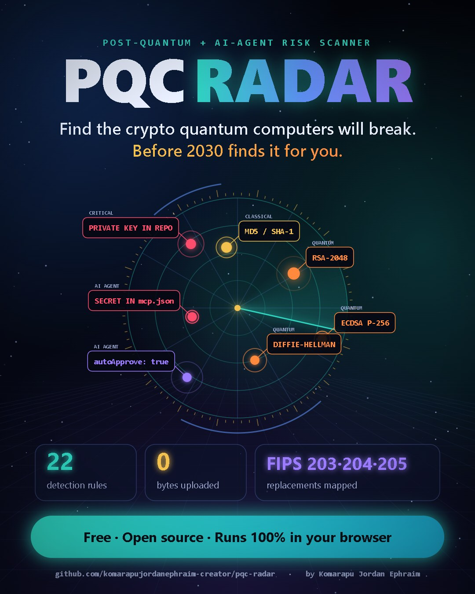

<p align="center">
  
</p>

# PQC Radar

**Find the cryptography quantum computers will break, and the AI-agent configs attackers will abuse. In your browser, with nothing uploaded.**

**Live demo:** https://komarapujordanephraim-creator.github.io/pqc-radar/ (add `?demo` to scan the sample repo on load)

PQC Radar is a single-page scanner. Drop a folder, drop files or paste code, and it shows:

- **Quantum exposure:** RSA, elliptic curves (ECDSA/ECDH), Ed25519/X25519, Diffie-Hellman, DSA, SSH RSA keys, RS/ES JWT algorithms.
- **Classical mistakes:** MD5, SHA-1, RC4, 3DES, ECB, keys of 1024 bits or less, TLS 1.0/1.1, private keys committed to source.
- **AI-agent config risks:** auto-approved tools, wildcard permissions, unpinned `npx`/`uvx` MCP servers, secrets in config, hidden instructions, invisible Unicode, plain-HTTP agent servers.
- **The replacement for each finding:** ML-KEM (FIPS 203), ML-DSA (FIPS 204), SLH-DSA (FIPS 205), AES-256, SHA-256, allow-lists.

You also get a readiness score, filters, fix guidance, and JSON, SARIF and Markdown export.

## Privacy

Everything runs locally in the page. There is no backend, no analytics and no network call during a scan. Open DevTools → Network and check for yourself.

## Run locally

```bash
git clone https://github.com/komarapujordanephraim-creator/pqc-radar.git
cd pqc-radar
python3 -m http.server 8000   # then open http://localhost:8000
```

Or just open `index.html` in a browser.

## Tests

```bash
node --test tests/scanner.test.js
```

The engine (`scanner.js`) works in the browser and in Node, so you can reuse it in scripts.

## Rules

| ID | Finding | Severity |
|---|---|---|
| QR001 | RSA in use | high |
| QR002 | Elliptic-curve crypto | high |
| QR003 | Ed25519 / X25519 family | high |
| QR004 | Diffie-Hellman | high |
| QR005 | DSA | high |
| QR006 | SSH RSA key | medium |
| QC001 | MD5 / SHA-1 | medium |
| QC002 | Weak or legacy cipher | medium |
| QC003 | Key size too small | high |
| QC004 | Old SSL / TLS | medium |
| QC005 | Private key committed | critical |
| QC006 | ECB mode | medium |
| QC007 | AES-128 | low |
| QA001 | Agent tools auto-approved | high |
| QA002 | Wildcard / bypassed permissions | high |
| QA003 | MCP server not pinned | medium |
| QA004 | Secret in config | critical |
| QA005 | Hidden instruction | high |
| QA006 | Exfiltration step | high |
| QA007 | Invisible Unicode | high |
| QA008 | Agent server over HTTP | medium |
| QP001 | Post-quantum algorithm referenced | info |

Add `pqc-radar: ignore` to a line you have reviewed to suppress it.

## Limitations

- Pattern-based, line by line. It does not parse code or follow data flow.
- It can miss crypto used through wrappers, runtime config or binaries, and it can flag harmless mentions.
- A clean result is **not** proof that a system is quantum-safe. Severity reflects general guidance, not your threat model.
- Timeline dates come from NIST IR 8547 (initial public draft, November 2024).

## Related tools

- [QuantumShield](https://github.com/komarapujordanephraim-creator/quantumshield): CLI and GitHub Action with dependency and lockfile scanning, plus SARIF.
- [AgentCrypt Scan](https://github.com/komarapujordanephraim-creator/agentcrypt-scan): AI-agent config and crypto scanner for CI.

Need a post-quantum readiness review of your repositories? [Message me on LinkedIn](https://www.linkedin.com/in/komarapu-jordan-ephraim-229a46329/).

## License

MIT
